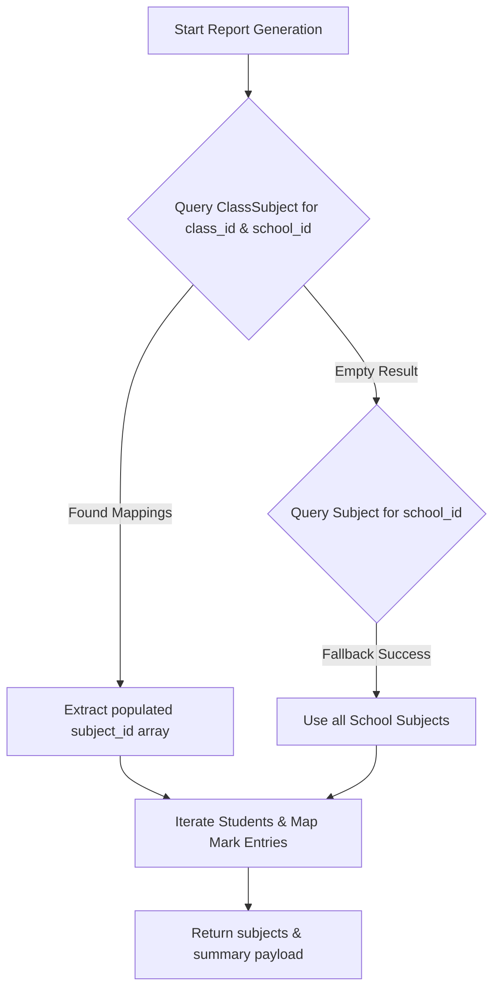

# School Admin Exam Report API Specification & Technical Documentation

This document provides a comprehensive, production-grade specification of all Application Programming Interfaces (APIs), database models, entity relationships, validation rules, grading algorithms, and reporting workflows for the **Exam Report Module** within the School Management System (School Admin Login).

---

## Table of Contents

1. [Architectural Overview & Reporting Flow](#1-architectural-overview--reporting-flow)
2. [Database Models & Entity Relationships](#2-database-models--entity-relationships)
3. [Summary of Discovered Exam Report APIs](#3-summary-of-discovered-exam-report-apis)
4. [Detailed API Endpoint Specifications](#4-detailed-api-endpoint-specifications)
   - [4.1 Get Exam List (`GET /api/schooladmin/exams`)](#41-get-exam-list-get-apischooladminexams)
   - [4.2 Create Exam (`POST /api/schooladmin/exams`)](#42-create-exam-post-apischooladminexams)
   - [4.3 Get Exam Report (`GET /api/schooladmin/exam-report`)](#43-get-exam-report-get-apischooladminexam-report)
     - [4.3.1 Class-Wise Performance Matrix Mode](#431-class-wise-performance-matrix-mode)
     - [4.3.2 Student-Wise Individual Scorecard Mode](#432-student-wise-individual-scorecard-mode)
   - [4.4 Get Exam Marks & Student Matrix (`GET /api/schooladmin/exam-marks`)](#44-get-exam-marks--student-matrix-get-apischooladminexam-marks)
   - [4.5 Save / Update Student Marks (`POST /api/schooladmin/exam-marks`)](#45-save--update-student-marks-post-apischooladminexam-marks)
     - [4.5.1 Format A: Bulk Student Grid Submission](#451-format-a-bulk-student-grid-submission)
     - [4.5.2 Format B: Single / Multi-Subject Direct Entry](#452-format-b-single--multi-subject-direct-entry)
   - [4.6 Bulk Import Exam Marks (`POST /api/schooladmin/exam-marks/bulk-import`)](#46-bulk-import-exam-marks-post-apischooladminexam-marksbulk-import)
   - [4.7 Auxiliary Filtering APIs (`Classes`, `Students`, `Subjects`)](#47-auxiliary-filtering-apis)
5. [Fulfillment of the 10 Required Exam Report Operations](#5-fulfillment-of-the-10-required-exam-report-operations)
6. [Exam Report Filters & Analytic Calculations](#6-exam-report-filters--analytic-calculations)
   - [6.1 Query Filters](#61-query-filters)
   - [6.2 Subject Resolution Hierarchy](#62-subject-resolution-hierarchy)
   - [6.3 Grading Scale Matrix](#63-grading-scale-matrix)
   - [6.4 Statistical Calculation Formulae](#64-statistical-calculation-formulae)
7. [API Verification & cURL Testing Guide](#7-api-verification--curl-testing-guide)

---

## 1. Architectural Overview & Reporting Flow

The Exam Report system provides institutional stakeholders with real-time academic analytics across school classes, sections, and individual students. The architecture coordinates four foundational data vectors: **Exams**, **Classes & Sections**, **Subjects**, and **Student Marks**.

```
+--------------------------------------------------------------------------------------------------+
|                                  School Admin Exam Report Architecture                            |
+--------------------------------------------------------------------------------------------------+
                                                 |
         +---------------------------------------+---------------------------------------+
         |                                                                               |
         v                                                                               v
+------------------------------------+                         +-----------------------------------+
|         Exam Management            |                         |      Academic Organization        |
|  - Exam collection:                |                         |  - Class collection (grade & sec) |
|    name, term, school_id           |                         |  - Subject collection             |
|  - Endpoint:                       |                         |  - ClassSubject (assigned map)    |
|    GET /api/schooladmin/exams      |                         |  - Student collection (profiles)  |
+------------------------------------+                         +-----------------------------------+
         |                                                                               |
         +---------------------------------------+---------------------------------------+
                                                 |
                                                 v
                               +-----------------------------------+
                               |     Marks Ingestion Engine        |
                               |  - ExamMark collection            |
                               |  - Dual Input Modes:              |
                               |    * Format A: Bulk Matrix Grid   |
                               |    * Format B: Single Record      |
                               |    * Bulk CSV/Excel Importer      |
                               +-----------------------------------+
                                                 |
                                                 v
                               +-----------------------------------+
                               |     Analytics & Report Engine     |
                               |  GET /api/schooladmin/exam-report |
                               +-----------------------------------+
                                                 |
         +---------------------------------------+---------------------------------------+
         |                                                                               |
         v                                                                               v
+------------------------------------+                         +-----------------------------------+
|  Mode 1: Class-Wide Matrix Report  |                         |  Mode 2: Student Scorecard Card   |
|  - Filters: exam_id, class_id      |                         |  - Filters: exam_id, class_id,   |
|  - Output: All class students with |                         |             student_id            |
|    per-subject scores & total      |                         |  - Output: Single student marks,  |
|  - Aggregations: Class Average,    |                         |    per-subject percentage, grade, |
|    Pass Rate %, Highest Score      |                         |    rank, and printable layout     |
+------------------------------------+                         +-----------------------------------+
```

### Architectural Core Principles
- **Multi-Tenant Isolation**: Every database interaction uses `getSchoolId(req.user._id)` to ensure all exams, marks, classes, and student entities are partitioned by the authenticated administrator's `school_id`.
- **Dual Query Modes in a Single Endpoint**: `GET /api/schooladmin/exam-report` automatically switches between full class comparative rosters and individual student printable report cards based on the presence of the `student_id` query parameter.
- **Fail-Safe Subject Resolution**: The reporting engine inspects `ClassSubject` mappings first. If a grade has no explicit subject assignments, it automatically falls back to school-wide `Subject` definitions, preventing empty scorecards.
- **Dynamic Grade Computation**: Standardized 6-tier grading scale is evaluated consistently across backend controllers and frontend viewports.

---

## 2. Database Models & Entity Relationships

The Exam Report module integrates six MongoDB collections via Mongoose tenant proxies.

```mermaid
erDiagram
    SCHOOL ||--o{ EXAM : owns
    SCHOOL ||--o{ CLASS : contains
    SCHOOL ||--o{ STUDENT : enrolls
    SCHOOL ||--o{ SUBJECT : offers
    SCHOOL ||--o{ CLASS_SUBJECT : links
    SCHOOL ||--o{ EXAM_MARK : stores

    CLASS ||--o{ STUDENT : assigns
    CLASS ||--o{ CLASS_SUBJECT : configures
    SUBJECT ||--o{ CLASS_SUBJECT : maps

    EXAM ||--o{ EXAM_MARK : evaluates
    STUDENT ||--o{ EXAM_MARK : receives
    CLASS ||--o{ EXAM_MARK : scopes

    EXAM_MARK ||--|{ MARK_ENTRY : contains
    SUBJECT ||--o{ MARK_ENTRY : references

    EXAM {
        ObjectId _id PK
        ObjectId school_id FK
        string name "e.g. Mid-Term Examination 2026"
        string term "e.g. Term 1"
        Date createdAt
        Date updatedAt
    }

    EXAM_MARK {
        ObjectId _id PK
        ObjectId exam_id FK
        ObjectId student_id FK
        ObjectId class_id FK
        ObjectId school_id FK
        string academic_year "default: 2026-2027"
        string remarks
        array marks "Embedded Mark Entries"
        Date createdAt
        Date updatedAt
    }

    MARK_ENTRY {
        ObjectId subject_id FK
        number marks_obtained "default: 0"
        number total_marks "default: 100"
        number passing_marks "default: 35"
        string grade "A+, A, A-, B, C, F"
        string remarks
        Date exam_date
    }

    STUDENT {
        ObjectId _id PK
        ObjectId school_id FK
        ObjectId class_id FK
        string student_name
        string roll_no
        string admission_number
        string photo
    }

    CLASS {
        ObjectId _id PK
        ObjectId school_id FK
        string class "e.g. Grade 10"
        string section "e.g. A"
    }

    SUBJECT {
        ObjectId _id PK
        ObjectId school_id FK
        string name "e.g. Mathematics"
        string code "e.g. MATH101"
        string type "Theory / Practical"
    }

    CLASS_SUBJECT {
        ObjectId _id PK
        ObjectId school_id FK
        ObjectId class_id FK
        ObjectId subject_id FK
    }
```

### Schema Definitions & Indexes

#### 1. `Exam` (`backend/src/models/Exam.js`)
```javascript
const examSchema = new mongoose.Schema({
    name: { type: String, required: true },
    term: { type: String, required: false },
    school_id: { type: mongoose.Schema.Types.ObjectId, ref: 'School', required: true }
}, { timestamps: true });

// Compound index enforcing unique exam names within a school
examSchema.index({ school_id: 1, name: 1 }, { unique: true });
```

#### 2. `ExamMark` (`backend/src/models/ExamMark.js`)
```javascript
const markEntrySchema = new mongoose.Schema({
    subject_id: { type: mongoose.Schema.Types.ObjectId, ref: 'Subject', required: true },
    marks_obtained: { type: Number, required: true, default: 0 },
    total_marks: { type: Number, required: true, default: 100 },
    passing_marks: { type: Number, required: false, default: 35 },
    grade: { type: String, required: false },
    remarks: { type: String, required: false, default: '' },
    exam_date: { type: Date, required: false }
});

const examMarkSchema = new mongoose.Schema({
    exam_id: { type: mongoose.Schema.Types.ObjectId, ref: 'Exam', required: true },
    student_id: { type: mongoose.Schema.Types.ObjectId, ref: 'Student', required: true },
    class_id: { type: mongoose.Schema.Types.ObjectId, ref: 'Class', required: true },
    school_id: { type: mongoose.Schema.Types.ObjectId, ref: 'School', required: true },
    academic_year: { type: String, required: false, default: '2026-2027' },
    remarks: { type: String, required: false, default: '' },
    marks: [markEntrySchema]
}, { timestamps: true });

// Compound index guaranteeing exactly one mark entry document per student per exam
examMarkSchema.index({ exam_id: 1, student_id: 1 }, { unique: true });
```

---

## 3. Summary of Discovered Exam Report APIs

All routes are registered in [`backend/src/routes/schoolAdminRoutes.js`](file:///Users/sabari/Documents/git/schoolapp/backend/src/routes/schoolAdminRoutes.js#L100-L105) and handled by [`backend/src/controllers/examController.js`](file:///Users/sabari/Documents/git/schoolapp/backend/src/controllers/examController.js).

| # | Endpoint Route | HTTP Method | Handler Function | Purpose | Access Control |
|---|----------------|-------------|------------------|---------|----------------|
| 1 | `/api/schooladmin/exams` | `GET` | `getExams` | Retrieves list of all configured exams for school | `Private` (`SchoolAdmin`) |
| 2 | `/api/schooladmin/exams` | `POST` | `createExam` | Creates a new exam session / term | `Private` (`SchoolAdmin`) |
| 3 | `/api/schooladmin/exam-report` | `GET` | `getExamReport` | Generates Class-wide matrix or Student scorecard | `Private` (`SchoolAdmin`) |
| 4 | `/api/schooladmin/exam-marks` | `GET` | `getExamStudentsMarks` | Fetches student marks matrix & assigned subjects | `Private` (`SchoolAdmin`) |
| 5 | `/api/schooladmin/exam-marks` | `POST` | `saveExamMarks` | Saves student marks (Bulk Grid or Single Student) | `Private` (`SchoolAdmin`) |
| 6 | `/api/schooladmin/exam-marks/bulk-import` | `POST` | `bulkImportExamMarks` | Bulk imports marks from CSV/Excel formatted data | `Private` (`SchoolAdmin`) |

*Endpoint Aliases Supported by `saveExamMarks`:*
- `POST /api/schooladmin/marks`
- `POST /api/schooladmin/add-marks`

---

## 4. Detailed API Endpoint Specifications

---

### 4.1 Get Exam List (`GET /api/schooladmin/exams`)

- **API Name**: Get All Exams
- **Route / Endpoint**: `/api/schooladmin/exams`
- **HTTP Method**: `GET`
- **Authentication**: Bearer Token required (`protect` middleware)
- **Authorized Roles**: `SchoolAdmin`
- **Required Headers**:
  ```http
  Authorization: Bearer <JWT_ACCESS_TOKEN>
  Content-Type: application/json
  ```
- **Request Query Parameters**: None. Automatically filtered by admin's `school_id`.
- **Request Payload**: None.
- **Database Models Used**:
  - `School` (`findOne({ admin_id })`)
  - `Exam` (`find({ school_id }).sort({ createdAt: -1 })`)

#### Success Response
- **Status Code**: `200 OK`
- **Content-Type**: `application/json`
```json
[
  {
    "_id": "673752e25779c17e3ef42301",
    "school_id": "67374fe95779c17e3ef42250",
    "name": "Mid-Term Examination 2026",
    "term": "Term 1",
    "createdAt": "2026-11-15T14:10:10.512Z",
    "updatedAt": "2026-11-15T14:10:10.512Z",
    "__v": 0
  },
  {
    "_id": "673753055779c17e3ef42315",
    "school_id": "67374fe95779c17e3ef42250",
    "name": "Annual Examination 2026",
    "term": "Final",
    "createdAt": "2026-11-15T14:10:45.890Z",
    "updatedAt": "2026-11-15T14:10:45.890Z",
    "__v": 0
  }
]
```

#### Error Responses
- **401 Unauthorized**:
  ```json
  { "message": "Not authorized, token failed" }
  ```
- **500 Internal Server Error**:
  ```json
  { "message": "Server error", "error": "Internal server error message" }
  ```

---

### 4.2 Create Exam (`POST /api/schooladmin/exams`)

- **API Name**: Create New Exam
- **Route / Endpoint**: `/api/schooladmin/exams`
- **HTTP Method**: `POST`
- **Authentication**: Bearer Token required (`protect` middleware)
- **Authorized Roles**: `SchoolAdmin`
- **Required Headers**:
  ```http
  Authorization: Bearer <JWT_ACCESS_TOKEN>
  Content-Type: application/json
  ```
- **Request Payload**:
```json
{
  "name": "Quarterly Examination 2026",
  "term": "Quarterly"
}
```

| Field | Type | Required | Description |
|-------|------|----------|-------------|
| `name` | String | Yes | Name of the exam (unique within the school). |
| `term` | String | No | Semester or term identifier (e.g., `Term 1`, `Quarterly`, `Final`). |

#### Success Response
- **Status Code**: `201 Created`
- **Content-Type**: `application/json`
```json
{
  "_id": "6738c92a5779c17e3ef42890",
  "school_id": "67374fe95779c17e3ef42250",
  "name": "Quarterly Examination 2026",
  "term": "Quarterly",
  "createdAt": "2026-11-16T16:45:30.120Z",
  "updatedAt": "2026-11-16T16:45:30.120Z",
  "__v": 0
}
```

#### Error Responses
- **400 Bad Request (Missing Required Name)**:
  ```json
  { "message": "Exam name is required" }
  ```
- **400 Bad Request (Duplicate Exam Name)**:
  ```json
  { "message": "An exam with this name already exists" }
  ```

---

### 4.3 Get Exam Report (`GET /api/schooladmin/exam-report`)

- **API Name**: Get Comprehensive Exam Report
- **Route / Endpoint**: `/api/schooladmin/exam-report`
- **HTTP Method**: `GET`
- **Authentication**: Bearer Token required (`protect` middleware)
- **Authorized Roles**: `SchoolAdmin`
- **Required Headers**:
  ```http
  Authorization: Bearer <JWT_ACCESS_TOKEN>
  ```
- **Request Query Parameters**:

| Parameter | Type | Required | Description |
|-----------|------|----------|-------------|
| `exam_id` | String (ObjectId) | Yes | MongoDB `_id` of the Exam. |
| `class_id` | String (ObjectId) | Yes | MongoDB `_id` of the Class section. |
| `student_id` | String (ObjectId) | No | Optional. If provided, filters report to that single student. If omitted, returns all students in the class. |

- **Database Models Used**:
  - `ExamMark` (`find({ exam_id, class_id })`)
  - `Student` (`find({ school_id, class_id, [_id: student_id] })`)
  - `ClassSubject` (`find({ class_id, school_id }).populate('subject_id')`)
  - `Subject` (Fallback: `find({ school_id })`)

---

#### 4.3.1 Class-Wise Performance Matrix Mode
*Request Example*: `GET /api/schooladmin/exam-report?exam_id=673752e25779c17e3ef42301&class_id=67374ffc5779c17e3ef42261`

##### Success Response
- **Status Code**: `200 OK`
- **Content-Type**: `application/json`
```json
{
  "subjects": [
    {
      "_id": "673750585779c17e3ef42275",
      "name": "Mathematics",
      "code": "MATH101",
      "type": "Theory",
      "school_id": "67374fe95779c17e3ef42250"
    },
    {
      "_id": "673750695779c17e3ef42280",
      "name": "Science",
      "code": "SCI102",
      "type": "Theory",
      "school_id": "67374fe95779c17e3ef42250"
    },
    {
      "_id": "6737507b5779c17e3ef42289",
      "name": "English",
      "code": "ENG103",
      "type": "Theory",
      "school_id": "67374fe95779c17e3ef42250"
    }
  ],
  "summary": [
    {
      "student_id": "6737512a5779c17e3ef42299",
      "name": "Aarav Sharma",
      "roll_no": "101",
      "admission_number": "ADM2026001",
      "photo": "https://school.bucket.s3.amazonaws.com/students/aarav.jpg",
      "subject_marks": [
        {
          "subject_id": "673750585779c17e3ef42275",
          "subject_name": "Mathematics",
          "subject_code": "MATH101",
          "marks_obtained": 92,
          "total_marks": 100,
          "percentage": 92,
          "grade": "A+"
        },
        {
          "subject_id": "673750695779c17e3ef42280",
          "subject_name": "Science",
          "subject_code": "SCI102",
          "marks_obtained": 88,
          "total_marks": 100,
          "percentage": 88,
          "grade": "A+"
        },
        {
          "subject_id": "6737507b5779c17e3ef42289",
          "subject_name": "English",
          "subject_code": "ENG103",
          "marks_obtained": 78,
          "total_marks": 100,
          "percentage": 78,
          "grade": "A"
        }
      ],
      "total_obtained": 258,
      "total_max": 300,
      "percentage": 86,
      "grade": "A+"
    },
    {
      "student_id": "6737514f5779c17e3ef422b2",
      "name": "Ananya Patel",
      "roll_no": "102",
      "admission_number": "ADM2026002",
      "photo": "",
      "subject_marks": [
        {
          "subject_id": "673750585779c17e3ef42275",
          "subject_name": "Mathematics",
          "subject_code": "MATH101",
          "marks_obtained": 65,
          "total_marks": 100,
          "percentage": 65,
          "grade": "A-"
        },
        {
          "subject_id": "673750695779c17e3ef42280",
          "subject_name": "Science",
          "subject_code": "SCI102",
          "marks_obtained": 54,
          "total_marks": 100,
          "percentage": 54,
          "grade": "B"
        },
        {
          "subject_id": "6737507b5779c17e3ef42289",
          "subject_name": "English",
          "subject_code": "ENG103",
          "marks_obtained": 72,
          "total_marks": 100,
          "percentage": 72,
          "grade": "A"
        }
      ],
      "total_obtained": 191,
      "total_max": 300,
      "percentage": 64,
      "grade": "A-"
    }
  ]
}
```

---

#### 4.3.2 Student-Wise Individual Scorecard Mode
*Request Example*: `GET /api/schooladmin/exam-report?exam_id=673752e25779c17e3ef42301&class_id=67374ffc5779c17e3ef42261&student_id=6737512a5779c17e3ef42299`

##### Success Response
- **Status Code**: `200 OK`
- **Content-Type**: `application/json`
```json
{
  "subjects": [
    {
      "_id": "673750585779c17e3ef42275",
      "name": "Mathematics",
      "code": "MATH101"
    },
    {
      "_id": "673750695779c17e3ef42280",
      "name": "Science",
      "code": "SCI102"
    },
    {
      "_id": "6737507b5779c17e3ef42289",
      "name": "English",
      "code": "ENG103"
    }
  ],
  "summary": [
    {
      "student_id": "6737512a5779c17e3ef42299",
      "name": "Aarav Sharma",
      "roll_no": "101",
      "admission_number": "ADM2026001",
      "photo": "https://school.bucket.s3.amazonaws.com/students/aarav.jpg",
      "subject_marks": [
        {
          "subject_id": "673750585779c17e3ef42275",
          "subject_name": "Mathematics",
          "subject_code": "MATH101",
          "marks_obtained": 92,
          "total_marks": 100,
          "percentage": 92,
          "grade": "A+"
        },
        {
          "subject_id": "673750695779c17e3ef42280",
          "subject_name": "Science",
          "subject_code": "SCI102",
          "marks_obtained": 88,
          "total_marks": 100,
          "percentage": 88,
          "grade": "A+"
        },
        {
          "subject_id": "6737507b5779c17e3ef42289",
          "subject_name": "English",
          "subject_code": "ENG103",
          "marks_obtained": 78,
          "total_marks": 100,
          "percentage": 78,
          "grade": "A"
        }
      ],
      "total_obtained": 258,
      "total_max": 300,
      "percentage": 86,
      "grade": "A+"
    }
  ]
}
```

#### Error Responses
- **400 Bad Request (Missing Query Parameters)**:
  ```json
  { "message": "Exam ID and Class ID are required" }
  ```
- **401 Unauthorized**:
  ```json
  { "message": "Not authorized, token failed" }
  ```
- **500 Internal Server Error**:
  ```json
  { "message": "Server error", "error": "Database connection timed out" }
  ```

---

### 4.4 Get Exam Marks & Student Matrix (`GET /api/schooladmin/exam-marks`)

Used to retrieve the class gradebook entry grid, combining all active students with currently recorded marks for each subject.

- **API Name**: Get Exam Student Marks Matrix
- **Route / Endpoint**: `/api/schooladmin/exam-marks`
- **HTTP Method**: `GET`
- **Authentication**: Bearer Token required (`protect` middleware)
- **Authorized Roles**: `SchoolAdmin`
- **Required Headers**:
  ```http
  Authorization: Bearer <JWT_ACCESS_TOKEN>
  ```
- **Request Query Parameters**:
  - `exam_id` (String, required): Exam ObjectId.
  - `class_id` (String, required): Class ObjectId.
- **Database Models Used**:
  - `ClassSubject` & `Subject`
  - `Student` (`select('student_name roll_no admission_number photo')`)
  - `ExamMark` (`find({ exam_id, class_id })`)

#### Success Response
- **Status Code**: `200 OK`
- **Content-Type**: `application/json`
```json
{
  "students": [
    {
      "student_id": "6737512a5779c17e3ef42299",
      "name": "Aarav Sharma",
      "roll_no": "101",
      "admission_number": "ADM2026001",
      "photo": "https://school.bucket.s3.amazonaws.com/students/aarav.jpg",
      "marks": [
        {
          "subject_id": "673750585779c17e3ef42275",
          "marks_obtained": 92,
          "total_marks": 100,
          "passing_marks": 35,
          "grade": "A+"
        },
        {
          "subject_id": "673750695779c17e3ef42280",
          "marks_obtained": 88,
          "total_marks": 100,
          "passing_marks": 35,
          "grade": "A+"
        }
      ]
    }
  ],
  "subjects": [
    {
      "_id": "673750585779c17e3ef42275",
      "name": "Mathematics",
      "code": "MATH101"
    },
    {
      "_id": "673750695779c17e3ef42280",
      "name": "Science",
      "code": "SCI102"
    }
  ]
}
```

---

### 4.5 Save / Update Student Marks (`POST /api/schooladmin/exam-marks`)

This endpoint supports two distinct payload formats:
1. **Format A**: Bulk grid submission (array of students with embedded subject marks).
2. **Format B**: Individual student entry with rich parameter aliasing (`student_id`, `admission_number`, `marks` array or single subject).

- **API Name**: Save / Record Exam Marks
- **Route / Endpoint**: `/api/schooladmin/exam-marks` (Aliases: `/marks`, `/add-marks`)
- **HTTP Method**: `POST`
- **Authentication**: Bearer Token required (`protect` middleware)
- **Authorized Roles**: `SchoolAdmin`
- **Required Headers**:
  ```http
  Authorization: Bearer <JWT_ACCESS_TOKEN>
  Content-Type: application/json
  ```

---

#### 4.5.1 Format A: Bulk Student Grid Submission

Used by the bulk mark entry UI (`AddMarks.jsx`).

##### Request Payload
```json
{
  "exam_id": "673752e25779c17e3ef42301",
  "class_id": "67374ffc5779c17e3ef42261",
  "student_marks": [
    {
      "student_id": "6737512a5779c17e3ef42299",
      "marks": [
        {
          "subject_id": "673750585779c17e3ef42275",
          "marks_obtained": 95,
          "total_marks": 100,
          "passing_marks": 35
        },
        {
          "subject_id": "673750695779c17e3ef42280",
          "marks_obtained": 89,
          "total_marks": 100,
          "passing_marks": 35
        }
      ]
    },
    {
      "student_id": "6737514f5779c17e3ef422b2",
      "marks": [
        {
          "subject_id": "673750585779c17e3ef42275",
          "marks_obtained": 72,
          "total_marks": 100,
          "passing_marks": 35
        },
        {
          "subject_id": "673750695779c17e3ef42280",
          "marks_obtained": 68,
          "total_marks": 100,
          "passing_marks": 35
        }
      ]
    }
  ]
}
```

##### Success Response
- **Status Code**: `200 OK`
```json
{
  "success": true,
  "message": "Marks updated successfully",
  "data": {
    "count": 2
  }
}
```

---

#### 4.5.2 Format B: Single / Multi-Subject Direct Entry

Supports granular individual mark submission or manual data-entry terminals with parameter auto-resolution.

##### Request Payload
```json
{
  "student_id": "6737512a5779c17e3ef42299",
  "admission_number": "ADM2026001",
  "exam_id": "673752e25779c17e3ef42301",
  "class_id": "67374ffc5779c17e3ef42261",
  "academic_year": "2026-2027",
  "marks": [
    {
      "subject_id": "673750585779c17e3ef42275",
      "marks_obtained": 85,
      "total_marks": 100,
      "passing_marks": 35,
      "remarks": "Excellent problem solving"
    }
  ],
  "remarks": "Term 1 regular exam"
}
```

##### Success Response
- **Status Code**: `200 OK`
```json
{
  "success": true,
  "message": "Marks recorded successfully",
  "data": {
    "_id": "6738df995779c17e3ef42991",
    "exam_id": "673752e25779c17e3ef42301",
    "student_id": "6737512a5779c17e3ef42299",
    "class_id": "67374ffc5779c17e3ef42261",
    "school_id": "67374fe95779c17e3ef42250",
    "academic_year": "2026-2027",
    "remarks": "Term 1 regular exam",
    "marks": [
      {
        "subject_id": "673750585779c17e3ef42275",
        "marks_obtained": 85,
        "total_marks": 100,
        "passing_marks": 35,
        "grade": "A+",
        "remarks": "Excellent problem solving",
        "_id": "6738df995779c17e3ef42992"
      }
    ],
    "summary": {
      "total_marks_obtained": 85,
      "total_max_marks": 100,
      "percentage": 85,
      "overall_grade": "A+",
      "result_status": "Pass"
    }
  }
}
```

#### Error Responses
- **400 Bad Request (Validation: Marks exceed Total Marks)**:
  ```json
  {
    "success": false,
    "message": "Obtained marks (105) cannot exceed maximum marks (100)"
  }
  ```
- **404 Not Found (Student not in school)**:
  ```json
  {
    "success": false,
    "message": "Student not found in this school"
  }
  ```

---

### 4.6 Bulk Import Exam Marks (`POST /api/schooladmin/exam-marks/bulk-import`)

Enables automated batch ingestion of marks from spreadsheet uploads (Excel / CSV).

- **API Name**: Bulk Import Student Exam Marks
- **Route / Endpoint**: `/api/schooladmin/exam-marks/bulk-import`
- **HTTP Method**: `POST`
- **Authentication**: Bearer Token required (`protect` middleware)
- **Authorized Roles**: `SchoolAdmin`, `Teacher`
- **Required Headers**:
  ```http
  Authorization: Bearer <JWT_ACCESS_TOKEN>
  Content-Type: application/json
  ```
- **Request Payload**:
```json
{
  "exam_id": "673752e25779c17e3ef42301",
  "class_id": "67374ffc5779c17e3ef42261",
  "subject_id": "673750585779c17e3ef42275",
  "marks_data": [
    {
      "roll_no": "101",
      "admission_number": "ADM2026001",
      "marks_obtained": 94,
      "total_marks": 100
    },
    {
      "roll_no": "102",
      "admission_number": "ADM2026002",
      "marks_obtained": 62,
      "total_marks": 100
    }
  ]
}
```

#### Success Response
- **Status Code**: `200 OK`
```json
{
  "success": true,
  "count": 2,
  "createdMarks": [ ... ],
  "errors": [],
  "message": "Successfully imported exam marks for 2 students"
}
```

#### Partial Success / Error Tracking Response
If certain rows cannot resolve a student by roll number or admission number, the API reports row-level errors without halting the entire batch:
```json
{
  "success": true,
  "count": 1,
  "createdMarks": [ ... ],
  "errors": [
    {
      "row": 2,
      "message": "Student not found for Roll/Adm No: ADM999999"
    }
  ],
  "message": "Successfully imported exam marks for 1 students"
}
```

---

### 4.7 Auxiliary Filtering APIs

To populate the Exam Report filter dropdowns, the following existing school admin APIs are used:

| Endpoint | Method | Purpose |
|----------|--------|---------|
| `/api/schooladmin/classes` | `GET` | Fetches available classes and sections for the class selector. |
| `/api/schooladmin/students` | `GET` | Fetches student rosters to populate student search dropdowns. |
| `/api/schooladmin/subjects` | `GET` | Lists all school subjects to support subject-level analysis. |

---

## 5. Fulfillment of the 10 Required Exam Report Operations

| # | Required Operation | Backend Endpoint & Method | Implementation Mechanism & Data Structure |
|---|--------------------|---------------------------|--------------------------------------------|
| 1 | **Get Exam List** | `GET /api/schooladmin/exams` | Returns all exams under `school_id`, sorted descending by creation date (`_id`, `name`, `term`, `createdAt`). |
| 2 | **Get Exam Report** | `GET /api/schooladmin/exam-report?exam_id={id}&class_id={id}` | Master report endpoint returning full `subjects` schema and all student rows in `summary`. |
| 3 | **Get Student-wise Exam Report** | `GET /api/schooladmin/exam-report?exam_id={id}&class_id={id}&student_id={id}` | Passes `student_id` query param to produce an isolated, printable scorecard for a single student. |
| 4 | **Get Class-wise Exam Report** | `GET /api/schooladmin/exam-report?exam_id={id}&class_id={id}` | Generates comparative performance roster for all students enrolled in the designated class and section. |
| 5 | **Get Subject-wise Marks Report** | `GET /api/schooladmin/exam-report` | Every student record in `summary` embeds `subject_marks` detailing `subject_name`, `subject_code`, `marks_obtained`, `total_marks`, `percentage`, and `grade`. |
| 6 | **Get Student Marks Details** | `GET /api/schooladmin/exam-marks?exam_id={id}&class_id={id}` | Returns real-time marks entry matrix with historical inputs and student metadata (`admission_number`, `roll_no`, `photo`). |
| 7 | **Get Academic Year-wise Exam Report** | `GET /api/schooladmin/exam-report` & `ExamMark` | `ExamMark` schema preserves `academic_year` (e.g., `2026-2027`). Filtering by exams scoped to the academic year provides yearly performance reporting. |
| 8 | **Get Exam Result Summary** | `GET /api/schooladmin/exam-report` | Returns aggregated metrics per student: `total_obtained`, `total_max`, overall `percentage`, and calculated `grade`. |
| 9 | **Get Student Grade and Percentage** | `GET /api/schooladmin/exam-report` & `calculateGrade` | Dynamically calculated for both individual subjects and composite totals: $\text{percentage} = \text{round}((\text{obtained}/\text{max}) \times 100)$, mapped to grades (`A+` through `F`). |
| 10 | **Get Pass / Fail Summary** | `GET /api/schooladmin/exam-report` (Analytics) | Computed from `summary` array: students with `grade !== 'F'` ($\ge 40\%$) pass, while students with `grade === 'F'` ($< 40\%$) fail. Expressed as Pass Rate $\%$. |

---

## 6. Exam Report Filters & Analytic Calculations

### 6.1 Query Filters

The reporting interface and backend endpoints support four primary filtering dimensions:

```
+-----------------------------------------------------------------------------------------------+
|                                    Exam Report Filter Cascade                                 |
+-----------------------------------------------------------------------------------------------+
|  1. Exam Selector         :  exam_id       (Required, ObjectId from /api/schooladmin/exams)  |
|  2. Class & Section       :  class_id      (Required, ObjectId from /api/schooladmin/classes)|
|  3. Student Filter        :  student_id    (Optional, ObjectId from /api/schooladmin/students)|
|  4. Academic Year Context :  academic_year (Stored in ExamMark, default: '2026-2027')         |
+-----------------------------------------------------------------------------------------------+
```

---

### 6.2 Subject Resolution Hierarchy

To guarantee that exam reports display all relevant subjects even if individual mappings have not been finalized, the backend executes the following resolution strategy:



---

### 6.3 Grading Scale Matrix

Both the backend controller function `calculateGrade(percentage)` and the frontend reporting interface evaluate student results using a uniform grading scale:

| Percentage Range | Grade Assigned | Academic Classification | Result Status | UI Badge Styling |
|------------------|----------------|-------------------------|---------------|------------------|
| **80% – 100%** | **A+** | Outstanding | **Pass** | Emerald Badge (`bg-emerald-50 text-emerald-650`) |
| **70% – 79%** | **A** | Excellent | **Pass** | Emerald Badge (`bg-emerald-50 text-emerald-650`) |
| **60% – 69%** | **A-** | Very Good | **Pass** | Blue Badge (`bg-blue-50 text-blue-650`) |
| **50% – 59%** | **B** | Good / Satisfactory | **Pass** | Blue Badge (`bg-blue-50 text-blue-650`) |
| **40% – 49%** | **C** | Acceptable / Minimum Pass | **Pass** | Amber Badge (`bg-amber-50 text-amber-650`) |
| **0% – 39%** | **F** | Needs Improvement | **Fail** | Rose Badge (`bg-rose-50 text-rose-600`) |

---

### 6.4 Statistical Calculation Formulae

The report page calculates the following class metrics dynamically across the returned `summary` array:

#### 1. Student Subject Percentage
$$\text{Subject Percentage} = \begin{cases} 
\text{round}\left(\frac{\text{marks\_obtained}}{\text{total\_marks}} \times 100\right), & \text{if } \text{total\_marks} > 0 \\ 
0, & \text{otherwise} 
\end{cases}$$

#### 2. Student Composite Percentage
$$\text{Overall Percentage} = \begin{cases} 
\text{round}\left(\frac{\text{total\_obtained}}{\text{total\_max}} \times 100\right), & \text{if } \text{total\_max} > 0 \\ 
0, & \text{otherwise} 
\end{cases}$$

#### 3. Class Average Score
$$\text{Class Average} = \begin{cases} 
\text{round}\left(\frac{\sum_{i=1}^{N} \text{percentage}_i}{N}\right), & \text{if } N > 0 \\ 
0, & \text{otherwise} 
\end{cases}$$
*(where $N$ is the total count of students in `summary`)*

#### 4. Class Pass Rate Percentage
$$\text{Pass Rate} = \begin{cases} 
\text{round}\left(\frac{\text{Count}(\text{grade} \neq \text{'F'})}{N} \times 100\right), & \text{if } N > 0 \\ 
0, & \text{otherwise} 
\end{cases}$$

#### 5. Highest Score in Class
$$\text{Highest Score} = \begin{cases} 
\max_{i=1}^{N} (\text{percentage}_i), & \text{if } N > 0 \\ 
0, & \text{otherwise} 
\end{cases}$$

#### 6. Pass / Fail Student Counts
$$\text{Total Passed} = \sum [\text{grade} \neq \text{'F'}], \quad \text{Total Failed} = \sum [\text{grade} == \text{'F'}]$$

---

## 7. API Verification & cURL Testing Guide

### 7.1 Fetching Exam List
```bash
curl -X GET "http://localhost:5000/api/schooladmin/exams" \
  -H "Authorization: Bearer YOUR_TOKEN_HERE" \
  -H "Content-Type: application/json"
```

### 7.2 Creating a New Exam
```bash
curl -X POST "http://localhost:5000/api/schooladmin/exams" \
  -H "Authorization: Bearer YOUR_TOKEN_HERE" \
  -H "Content-Type: application/json" \
  -d '{
    "name": "Second Term Examination 2026",
    "term": "Term 2"
  }'
```

### 7.3 Generating Class-Wise Exam Report
```bash
curl -X GET "http://localhost:5000/api/schooladmin/exam-report?exam_id=673752e25779c17e3ef42301&class_id=67374ffc5779c17e3ef42261" \
  -H "Authorization: Bearer YOUR_TOKEN_HERE" \
  -H "Content-Type: application/json"
```

### 7.4 Generating Student-Wise Scorecard Report
```bash
curl -X GET "http://localhost:5000/api/schooladmin/exam-report?exam_id=673752e25779c17e3ef42301&class_id=67374ffc5779c17e3ef42261&student_id=6737512a5779c17e3ef42299" \
  -H "Authorization: Bearer YOUR_TOKEN_HERE" \
  -H "Content-Type: application/json"
```

### 7.5 Saving Exam Marks (Bulk Grid)
```bash
curl -X POST "http://localhost:5000/api/schooladmin/exam-marks" \
  -H "Authorization: Bearer YOUR_TOKEN_HERE" \
  -H "Content-Type: application/json" \
  -d '{
    "exam_id": "673752e25779c17e3ef42301",
    "class_id": "67374ffc5779c17e3ef42261",
    "student_marks": [
      {
        "student_id": "6737512a5779c17e3ef42299",
        "marks": [
          {
            "subject_id": "673750585779c17e3ef42275",
            "marks_obtained": 95,
            "total_marks": 100,
            "passing_marks": 35
          }
        ]
      }
    ]
  }'
```

### 7.6 Bulk Ingestion from CSV / Excel Data
```bash
curl -X POST "http://localhost:5000/api/schooladmin/exam-marks/bulk-import" \
  -H "Authorization: Bearer YOUR_TOKEN_HERE" \
  -H "Content-Type: application/json" \
  -d '{
    "exam_id": "673752e25779c17e3ef42301",
    "class_id": "67374ffc5779c17e3ef42261",
    "subject_id": "673750585779c17e3ef42275",
    "marks_data": [
      {
        "roll_no": "101",
        "admission_number": "ADM2026001",
        "marks_obtained": 91,
        "total_marks": 100
      }
    ]
  }'
```

---

## 8. Summary of Source Code File Locations

| Component | Physical File Path |
|-----------|--------------------|
| **Routes** | [`backend/src/routes/schoolAdminRoutes.js`](file:///Users/sabari/Documents/git/schoolapp/backend/src/routes/schoolAdminRoutes.js) |
| **Controller** | [`backend/src/controllers/examController.js`](file:///Users/sabari/Documents/git/schoolapp/backend/src/controllers/examController.js) |
| **Exam Model** | [`backend/src/models/Exam.js`](file:///Users/sabari/Documents/git/schoolapp/backend/src/models/Exam.js) |
| **ExamMark Model** | [`backend/src/models/ExamMark.js`](file:///Users/sabari/Documents/git/schoolapp/backend/src/models/ExamMark.js) |
| **Student Model** | [`backend/src/models/Student.js`](file:///Users/sabari/Documents/git/schoolapp/backend/src/models/Student.js) |
| **Class Model** | [`backend/src/models/Class.js`](file:///Users/sabari/Documents/git/schoolapp/backend/src/models/Class.js) |
| **Subject Model** | [`backend/src/models/Subject.js`](file:///Users/sabari/Documents/git/schoolapp/backend/src/models/Subject.js) |
| **ClassSubject Model** | [`backend/src/models/ClassSubject.js`](file:///Users/sabari/Documents/git/schoolapp/backend/src/models/ClassSubject.js) |
| **Frontend Report Page** | [`frontend/src/pages/schooladmin/ExamReport.jsx`](file:///Users/sabari/Documents/git/schoolapp/frontend/src/pages/schooladmin/ExamReport.jsx) |
| **Frontend Marks Entry** | [`frontend/src/pages/schooladmin/AddMarks.jsx`](file:///Users/sabari/Documents/git/schoolapp/frontend/src/pages/schooladmin/AddMarks.jsx) |
